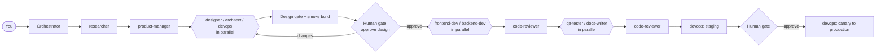

<div align="center">

# Muffy

### One skill, ten subagents, one feature from research to production.

**Describe a feature. The team researches, designs, builds, reviews, tests, and ships it, with a human approving the design before code starts and every production release.**

[Quick start](#quick-start) · [How muffy works](#how-muffy-works) · [What each step produces](#what-each-step-produces) · [Example](#example) · [FAQ](#faq) · [Documentation](#documentation)

<code>node install.mjs /path/to/your-repo --vault "/path/to/Obsidian Vault"</code>

</div>

---

You have a feature to build and a Claude Code session. Ask the `muffy` skill to run it. The main session becomes the **Orchestrator** and starts specialist subagents in a fixed 12-step flow: research, product, design, architecture, devops, frontend, backend, review, QA, docs. Each step has an owner, its inputs, and a gate. Work moves as files in `.team/<task>/` plus a validated JSON hand-off, not as chat summaries.

Small bugs and cosmetic fixes use a lighter [fix lane](#fix-lane) instead of the full flow.

The flow replaces ad-hoc multi-agent prompts. Unreviewed code and lost hand-offs stop reaching `main`; a repeated failure stops after three fix loops and goes to you.

## Quick start

Requires Node 18+. No runtime dependencies.

### Install into your repo

Run from anywhere, pointing at the target repo root:

```bash
node install.mjs /path/to/your-repo --vault "/absolute/path/to/Obsidian Vault"
```

The installer copies the agents to `.claude/agents/` and the skill to `.claude/skills/muffy/`, writes `VERSION` and `MANIFEST.json`, and adds ignore lines to `.gitignore`. Restart Claude Code afterward.

| Flag | What it does |
|---|---|
| `--dry-run` | Preview every change without writing |
| `--clean` | Update: remove the previous install first, including agent files a newer version dropped |
| `--scan` | Scan an existing repo and write `.team/onboard/scan.json` for `/muffy onboard` |
| `--with-guard` | Merge only the `.env` guard into `hooks.PreToolUse` |

Other hooks are not installed automatically. Merge `team-flow-settings-template.json` into `.claude/settings.local.json` by hand. Full steps: [INSTALL.md](INSTALL.md).

### Find unfinished work first (once)

```text
/muffy analyze
```

Before muffy takes over a repo that already has history, analyze lists what is half done: unmerged branches, stashes, uncommitted changes, TODO markers, skipped tests, and open items from GitHub, GitLab, Jira, ClickUp or any tracker that exports CSV or JSON. You confirm each group; only confirmed items become tasks that `/muffy resume` can continue. It can run from a checkout of muffy against a repo that does not have muffy yet:

```bash
node skills/muffy/scripts/scan-pending.mjs /path/to/your-repo --import jira=issues.csv --out pending.json
```

Privacy: read-only and offline. Only id, title, status, url and date are read; descriptions, comments and people are never read or stored; emails, tokens and url queries are redacted; nothing is written back to a tracker. Details: [analyze](skills/muffy/references/analyze.md).

### Onboard an existing codebase (once)

```text
/muffy onboard
```

The researcher and architect record the current stack as `docs/architecture/baseline.md` and an ADR. You review the baseline at a Human gate. After approval, onboard adds a short muffy block to `CLAUDE.md` / `AGENTS.md` (created if missing, never touching other lines). Skip this for a new, empty repo.

### Ask for a feature

```text
/muffy add password reset, task name password-reset
```

The Orchestrator confirms the scope (and, for user-facing features, offers an optional release announcement; it is off unless you say yes), then runs the steps. Before research and planning, the researcher and product manager may ask you clarifying questions through the Orchestrator.

### Fix a small bug or cosmetic issue

```text
/muffy fix login redirects to the old page after password reset
```

The fix lane skips research, product, design and architecture. A dev agent first **diagnoses** (reproduces the problem, finds the cause, no code yet), then fixes it with a regression test in the same context. `code-reviewer`, `qa-tester`, staging and the Human gate still run. The cause may be unknown at the start; if the diagnosis finds the problem is in the contract, a dependency or the stack, or the fix touches more than 5 source files, the run is promoted to the full flow. Details: [fix-profile](skills/muffy/references/fix-profile.md).

### Update muffy

Run the installer again with `--clean`, and restart Claude Code.

## How muffy works

The Orchestrator starts each step, routes hand-offs, runs the gates, and is the only role that merges. Subagents never talk to each other.



Every agent ends with a JSON block checked against `handoff.schema.json`; an invalid block is sent back, and invalid twice escalates. Instructions load per step from `skills/muffy/references/`, so no agent carries the whole brief.

### With and without the skill

<table>
  <thead>
    <tr>
      <th align="left">Topic</th>
      <th align="left">With muffy</th>
      <th align="left">Without muffy</th>
    </tr>
  </thead>
  <tbody>
    <tr>
      <td>Order of work</td>
      <td>Fixed 12-step flow; each step has an owner and inputs</td>
      <td>Agents run in whatever order the prompt suggests</td>
    </tr>
    <tr>
      <td>Hand-offs</td>
      <td>Files in <code>.team/&lt;task&gt;/</code> plus a validated JSON block</td>
      <td>Chat summaries that the next agent may misread</td>
    </tr>
    <tr>
      <td>Requirements</td>
      <td>Researcher and PM ask you questions before writing the brief and acceptance criteria</td>
      <td>Agents guess the gaps</td>
    </tr>
    <tr>
      <td>Review</td>
      <td>Design approval before code; code review and QA gates; Human gate before production</td>
      <td>Depends on whether someone remembers to ask</td>
    </tr>
    <tr>
      <td>Failures</td>
      <td>Max 3 fix loops, early stop on a repeated blocker, then escalation</td>
      <td>Retries continue until the user intervenes</td>
    </tr>
    <tr>
      <td>Secrets</td>
      <td><code>.env*</code> files are never read or printed; guard hook available</td>
      <td>An agent may paste a key into chat</td>
    </tr>
    <tr>
      <td>Tokens</td>
      <td>Per-step references, terse final messages, large files split into index + parts</td>
      <td>Every agent gets the full brief in its prompt</td>
    </tr>
    <tr>
      <td>Reuse</td>
      <td>Same flow for every feature and repo</td>
      <td>Rebuilt for each feature</td>
    </tr>
  </tbody>
</table>

## What each step produces

| Step | Owner | Output |
|---|---|---|
| 0 | `researcher`, `architect` (existing repos, once) | `docs/architecture/baseline.md`, `docs/adr/NNNN-existing-stack.md` |
| 1 | `researcher` | `brief.md` at the research level the feature needs |
| 2 | `product-manager` | `ac.md`, `docs/plan/<task>.md` (phases with value/cost/risk, P0/P1/P2), ADRs, `docs/strategy.md` (first feature only) |
| 3 | `designer` ∥ `architect` ∥ `devops` | `design.md`, `contract.md` (index + parts, with Cost), `deploy.md` |
| 3b | Orchestrator | Design canvas published on Claude Design; URL saved in `design.md`, `checkpoint.md`, and the vault task note |
| 3c / 3d | Design gate (checklist, then **you approve the design**), `devops` smoke build (only on stack change) | Pass or send back. Blocks code until both pass |
| 4 | `frontend-dev` ∥ `backend-dev` | `fe/<task>` and `be/<task>` branches in separate worktrees |
| 5 | Orchestrator | Merge into `feature/<task>` with `--no-ff` |
| 5b | Orchestrator (**off by default**) | PR diagrams as one Claude Artifact, when you ask for them |
| 6 | `code-reviewer` | Approve or Reject, saved as `review-<n>.md` |
| 7 | `qa-tester` ∥ `docs-writer` | `qa-report.md`, docs, `release-notes.md` (+ announcement if you opted in) |
| 8 | `code-reviewer` | Approve or Reject on docs and fixes |
| 9 | `devops` | Staging deploy: health check and smoke test |
| 10 | **Human gate** | You approve or reject with the QA report and staging result in front of you |
| 11 | `devops` | Canary, then 100% or rollback |
| 12 | Orchestrator | Final checks and a short report to you |

Large `ac` and `brief` files split into an index plus part files once they pass 60 lines; `contract.md` is always an index with one part file per section. Details: [steps](skills/muffy/references/steps.md).

### Run profile

The Orchestrator skips steps the feature does not need (no UI change skips design and frontend; no public API change skips docs). It never skips review, QA, staging, or the Human gate. Skipped steps and the reason are recorded in the vault task note. See [run-profile](skills/muffy/references/run-profile.md).

### Fix lane

`/muffy fix <description>` runs a shorter path for a small bug or a cosmetic change. A request also goes there when the Orchestrator's triage finds all of: a symptom with a location or a repro, at most 5 source files, no change to the API, schema, auth, dependencies or stack, and no new screen or component. Otherwise it runs the full flow. Example requests for both sides are in [fix-profile](skills/muffy/references/fix-profile.md#examples).

| Step | Owner | What happens |
|---|---|---|
| Setup-lite | Orchestrator | Writes `fix.md` (symptom, cause, repro, AC); one confirmation at `pause:scope` |
| 4a | `frontend-dev` / `backend-dev` | Diagnose, no code: reproduce, find the cause, record it in `fix.md` and a `diagnosis` hand-off |
| 4 | same agent | Fix plus a regression test that fails before and passes after |
| 6, 7 | `code-reviewer`, `qa-tester` | Review and QA against `fix.md`; a cosmetic AC with no automated check is marked `manual` |
| 9, 10, 11 | `devops`, Human gate | Staging, your approval, production, as in the full flow |

Research, product, design, architecture, docs and step 8 are skipped. The cause may be unknown at the start: an `unknown` diagnosis asks you for more evidence once, then escalates. A diagnosis that finds the cause in the contract, a dependency or the stack (`needs-full-flow`), or a fix that touches more than 5 source files, is promoted to the full flow.

### Gates and pauses

| Gate or pause | When | Resumes when |
|---|---|---|
| `pause:scope` | Setup (fix lane: one short question with the classification and AC list) | You confirm the scope |
| `pause:onboard-review` | Onboard step 0d | You approve or edit the baseline, ADR, and agent-context change |
| `pause:design-review` (3c) | After design, once the designer's definition of done is fully checked | You approve the design (or request changes and approve the revision). Nothing goes to `frontend-dev` / `backend-dev` before this |
| Smoke build (3d) | After devops mode 1, only when the stack changes (new runtime, dependency or devops-owned file) or no smoke has passed yet | Real dependencies run in one process. Feature-only changes skip it; staging still smoke-tests |
| `pause:staging-credentials` | Before a live call to an external API | You approve each call and the keys are confirmed by name and prefix |
| `pause:human-gate` | Step 10 | You answer Approve or Reject |

You approve the design before any code is written; only the Human gate approves production.

### Memory

| Where | What |
|---|---|
| `docs/` in the repo | Plan, ADRs, project strategy and budget, design system, architecture baseline |
| `.team/<task>/` | Working files, hand-offs, rounds, and `checkpoint.md` for resuming a run |
| Obsidian vault (`SECOND_BRAIN_VAULT`) | `tasks/<task>.md` and the consolidated `project.md` |

Details: [memory model](skills/muffy/references/memory-model.md).

### The team

| Agent | Role |
|---|---|
| `researcher` | Brief, evidence, onboard baseline; asks clarifying questions |
| `product-manager` | Acceptance criteria, plan, strategy score, project goal and budget |
| `designer` | Canvas, `design.md`, and the project design system |
| `architect` | API contract, ADRs, stack decisions, build vs buy, cost delta |
| `devops` | Deploy plan, smoke build, staging, production rollout |
| `frontend-dev` | UI implementation on `fe/<task>` |
| `backend-dev` | API and data implementation on `be/<task>` |
| `code-reviewer` | Read-only review of code and docs |
| `qa-tester` | Tests against acceptance criteria |
| `docs-writer` | Docs and release notes (optional announcement) |

## Example

Request in the main session: `/muffy add password reset, task name password-reset`

<details open>
<summary><strong>Walkthrough</strong></summary>

1. **Setup.** The Orchestrator confirms the scope with you and creates `.team/password-reset/`.
2. **Research and plan.** `researcher` asks a few clarifying questions through the Orchestrator, then writes `brief.md`. `product-manager` writes `ac.md` and `docs/plan/password-reset.md`.
3. **Parallel design.** `designer`, `architect`, and `devops` run together and produce `design.md`, `contract.md`, and `deploy.md`. The Orchestrator publishes the canvas and saves its URL. The design gate (checklist plus your approval of the canvas) and the smoke build must pass before code starts.
4. **Build.** `frontend-dev` and `backend-dev` work on `fe/password-reset` and `be/password-reset`. The Orchestrator merges them into `feature/password-reset`.
5. **Review and QA.** `code-reviewer` approves or rejects. `qa-tester` writes `qa-report.md` while `docs-writer` writes the docs and release notes.
6. **Release.** `devops` deploys to staging. You approve at the Human gate, then `devops` rolls out to production with a canary and a rollback path.

</details>

## FAQ

<details>
<summary><strong>When should I not use muffy?</strong></summary>

For one-line edits with no behaviour risk, research-only or review-only requests, and step-by-step iteration in the main session. The full flow pays off for a feature that touches several roles; a small bug or cosmetic fix uses `/muffy fix` instead.

</details>

<details>
<summary><strong>Do I need an Obsidian vault?</strong></summary>

The vault holds task notes and the consolidated `project.md`. Pass `--vault` at install, or set `SECOND_BRAIN_VAULT` in `.claude/settings.local.json`. If it is missing, the Orchestrator asks you.

</details>

<details>
<summary><strong>Can it deploy to production without me?</strong></summary>

No. Production rollout starts only after you approve at the Human gate, with "Human approved" in the prompt.

</details>

<details>
<summary><strong>Can the frontend and backend start before I approve the design?</strong></summary>

No. After the designer's checklist passes, the run stops at `pause:design-review` with the canvas link. `frontend-dev` and `backend-dev` start only after you approve; if you request changes, the designer revises and asks you again.

</details>

<details>
<summary><strong>What if a fix loop never converges?</strong></summary>

A point rejected four times, or one blocker open across three consecutive rejects, stops the loop and asks you. The cut-off is saved as `escalation-<n>.json`. See [loops](skills/muffy/references/loops.md).

</details>

<details>
<summary><strong>Does muffy read my secrets?</strong></summary>

Agents never read, grep, or print `.env*` files in full; they check a variable by name and prefix only. `--with-guard` installs a hook that blocks it. A key shown in chat must be rotated and logged in the checkpoint. See [hooks enforcement](skills/muffy/references/hooks-enforcement.md).

</details>

<details>
<summary><strong>How do I resume an interrupted run?</strong></summary>

The Orchestrator reads `.team/<task>/checkpoint.md` and the vault task note instead of replaying the conversation. `checkpoint.md` records the step reached, open blockers, the active pause and its resume condition, and the design canvas URL.

</details>

## Documentation

- [INSTALL.md](INSTALL.md): installer flags, hooks, and settings.
- [SKILL.md](skills/muffy/SKILL.md): the skill entry point and its rules.
- [Steps](skills/muffy/references/steps.md) and [run profile](skills/muffy/references/run-profile.md): who does what, and what can be skipped.
- [Fix profile](skills/muffy/references/fix-profile.md): the lane for small bugs and cosmetic fixes, with diagnose-first and promotion rules.
- [Requirements interview](skills/muffy/references/requirements.md): how clarifying questions reach you.
- [Onboard](skills/muffy/references/onboard.md): baseline, ADR, and `CLAUDE.md` / `AGENTS.md` for existing repos.
- [Loops](skills/muffy/references/loops.md): fix-loop limits, fallback ladder, escalation.
- [Quality checks](skills/muffy/references/quality-checks.md) and [evals](evals/README.md): how each step is verified.

## Contributing

```bash
npm test             # lint + offline evals (also runs in CI)
npm run lint         # prompt/link lint only
npm run eval         # offline evals only (loop rules, fix-lane triage, schemas)
npm run eval:sync    # re-copy each agent's rubric from its quality-checks.md
npm run package      # stage a clean copy in dist/muffy (no .git, no personal config)
```

- Personal config: copy `settings.local.json.template` to `.claude/settings.local.json` (gitignored).
- CI: [.github/workflows/ci.yml](.github/workflows/ci.yml) runs lint, evals, and the package check on every push and PR.
