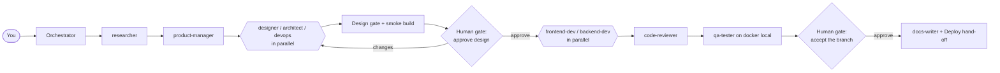

<div align="center">

# Muffy

### One skill, thirteen subagents, one feature from research to a branch you can deploy.

**Describe a feature. The team researches, designs, builds, reviews and tests it on docker local, with a human approving the design before code starts and the branch before it is handed over. Deploying is your step: the team never touches staging or production.**

[Quick start](#quick-start) · [Commands](#commands) · [How muffy works](#how-muffy-works) · [What each step produces](#what-each-step-produces) · [Example](#example) · [FAQ](#faq) · [Documentation](#documentation)

<code>node install.mjs /path/to/your-repo --vault "/path/to/Obsidian Vault"</code>

</div>

---

You have a feature to build and a Claude Code session. Ask the `muffy` skill to run it. The main session becomes the **Orchestrator** and starts specialist subagents in a fixed 12-step flow: research, product, design, architecture, devops, frontend, backend, review, QA, docs. Each step has an owner, its inputs, and a gate. Work moves as files in `.team/<task>/` plus a validated JSON hand-off, not as chat summaries.

You don't pick a lane or remember commands. Type what you want in your own words; muffy picks the smallest route that gets it done, shows you the plan (what runs, what is skipped and why, where it stops), and starts when you say go. Lanes and steps are explained in [How muffy works](#how-muffy-works).

The flow replaces ad-hoc multi-agent prompts. Unreviewed code and lost hand-offs stop reaching `main`; a repeated failure stops after three fix loops and goes to you.

## Quick start

Requires Node 18+. No runtime dependencies. Optional: the `impeccable` skill, which the Orchestrator uses for a UX/UI review of the design canvas before you approve it.

### Install into your repo

Run from anywhere, pointing at the target repo root:

```bash
node install.mjs /path/to/your-repo --vault "/absolute/path/to/Obsidian Vault"
```

The installer copies the agents to `.claude/agents/` and the skill to `.claude/skills/muffy/`, writes `VERSION` and `MANIFEST.json`, and adds ignore lines to `.gitignore`. Restart Claude Code afterward.

| Flag | What it does |
|---|---|
| `--dry-run` | Preview every change without writing |
| `--clean` | Update: remove the previous install first, including agent files a newer version dropped |
| `--no-scan` | Skip the repo scan (by default the installer writes `.team/onboard/scan.json`, the input for onboarding) |
| `--with-guard` | Merge the env, Bash-allowlist, full-regression, test-level, write-scope, git and gate guards into `hooks.PreToolUse` |

The checkpoint and artifact size hooks are opt-in and added by hand; team-flow rules 1–4 are Orchestrator rules, not hooks. Full steps: [INSTALL.md](INSTALL.md).

### Use it

```text
/muffy <what you want, in your own words>
/muffy
```

The first form does the work; a bare `/muffy` shows the menu: unfinished tasks to continue, what muffy knows about the project, and what else it can do.

| You type | What happens | Under the hood |
|---|---|---|
| `/muffy ปุ่ม Submit หน้า checkout สีผิดใน dark mode` | Finds the cause first (no code), a second model checks it, then the fix with a regression test, review, QA and your approval | fix |
| `/muffy ปรับ flow การใช้คูปองให้ซ้อนกันได้ และคำนวณยอดรวมใหม่` | Asks whether the look, the rules or both change, then AC, design or contract for you to approve, build, review, QA | change |
| `/muffy query หน้า orders ช้า p95 1.8 วิ ช่วยเพิ่ม index ให้หน่อย (แนบ EXPLAIN ANALYZE)` | Contract for the change, the index, before and after numbers at your approval | change |
| `/muffy ทำระบบรีเซ็ตรหัสผ่านให้หน่อย` | Research, user stories and plan (you approve), design (you approve), build, review, QA, your approval, docs | full flow |
| `/muffy ออกแบบหน้าจอให้ก่อน ยังไม่ต้องเขียนโค้ด` | Screens only, stops at the design you approve | design |
| `/muffy ช่วยรีวิว PR #42 ก่อน merge หน่อย` | Code review only; the verdict in chat | review |
| `/muffy ทำสไลด์สรุปฟีเจอร์ login ให้ลูกค้า` | Asks who the audience is, then a deck you review | present |
| `/muffy หาสาเหตุให้หน่อยว่าทำไมหน้า login redirect กลับหน้าเดิมหลัง reset password ยังไม่ต้องแก้` | Finds the cause, a second model checks it, then stops: no code, the cause and repro in `fix.md` | fix |
| `/muffy ช่วยรีวิวและเทส branch feature/export-csv ให้ครบก่อน merge หน่อย` | Reviews and tests your branch on a copy, reports, and asks before fixing anything; your branch is never edited or merged | verify |
| `/muffy อัปเกรด React เป็น 19 แล้วแก้ส่วนที่พังให้หน่อย` | Reads the changelog, an upgrade ADR you approve, a stack smoke, the fixes, review, QA with full regression offered | upgrade |
| `/muffy ทำต่อจากเมื่อวาน` | Picks up the unfinished task where it stopped | resume |
| `/muffy เจอบั๊ก แก้ไขให้หน่อย` | Asks what happens and where first: nothing starts on a guess | ask |

Before anything starts you see the plan, for example:

```text
แผน: แก้บั๊ก
ขั้นตอน: หาสาเหตุ (ยังไม่แก้โค้ด) → อีกโมเดลตรวจสาเหตุซ้ำ → แก้โค้ด + regression test → รีวิวโค้ด → เทสบน docker local → คุณอนุมัติ branch → เขียนเอกสาร + Deploy hand-off (ถ้าจำเป็น)
ข้าม: วิจัยข้อมูล, เขียน user story และแผน, ออกแบบหน้าจอ, API และ infra (มีอาการและจุดที่เกิดชัดแล้ว)
หยุดที่: branch ที่ผ่าน QA บน docker local (ไม่ deploy ให้)
```

Answer go, stop earlier ("แค่วางแผน", "ยังไม่ต้องเขียนโค้ด"), or bigger or smaller. Nothing is deployed: the work ends on a branch you accept.

### Onboarding an existing codebase (automatic)

You don't run it yourself. The first request on a repo with code but no `docs/architecture/baseline.md` asks once to look around first, then carries on with that request. A bug fix or internal change gets a quick baseline (stack, layout, commands; no review); a redesign or a new feature gets the full one (baseline, stack ADR, design-system README) and you review it at a Human gate, answering the `[verify]` items one by one. After approval, onboard adds a short muffy block to `CLAUDE.md` / `AGENTS.md` (created if missing, never touching other lines). When the code has moved on (baseline yellow), the next task refreshes it without asking. `/muffy onboard` still runs it by hand. Details: [onboard](skills/muffy/references/onboard.md).

### Make a presentation for a client or end-users

```text
/muffy present roadmap for the client, from the plan and the ADRs
```

Outside the team flow. The product manager, thinking like a solutions engineer, asks who the audience is, drafts an outline for you to confirm, then writes the content; the designer turns it into a slide show (one slide at a time, Auto-play with captions). You also get an outline and `data.csv` you can edit in Canva, Google Slides or PowerPoint. Every number and date must trace to a source; nothing internal (agent names, ticket ids, branches) reaches the slides. You are the reviewer. Details: [present](skills/muffy/references/present.md).

### Draw a diagram

```text
/muffy diagram architecture of the billing service
```

Outside the team flow. The Orchestrator sends the request to the agent that owns the facts for that diagram kind (architecture, deployment, state, ERD, flow, screen map, gantt, story map), and the `diagrammer` agent draws it and checks that it renders. PNG or SVG export only on request. Details: [diagram](skills/muffy/references/diagram.md).

### Update muffy

Run the installer again with `--clean`, and restart Claude Code.

## Commands

| Command | Use it for |
|---|---|
| `/muffy <request>` | Anything: muffy picks the route and shows the plan before it starts |
| `/muffy` | The menu: unfinished tasks, what muffy knows about the project, decks and diagrams |

Shortcuts, when you already know the route (each still shows its plan and keeps every gate):

| Shortcut | Goes straight to |
|---|---|
| `/muffy fix <request>` | The [fix lane](#fix-lane): a bug or cosmetic fix with a symptom |
| `/muffy lite <request>` | The [change lane](#change-lane), internal scope: work nothing a user sees |
| `/muffy redesign <request>` | The [change lane](#change-lane), a visible scope: a screen, UX flow or business rule that exists |
| `/muffy feature <request>` | The full flow, no triage |
| `/muffy resume <task>` | That task, from its checkpoint (`/muffy resume` alone goes into the only unfinished task, or shows the menu) |
| `/muffy present <request>` | A client or end-user deck |
| `/muffy diagram <request>` | A standalone diagram |
| `/muffy onboard` | Look at the project again now (it also happens on its own) |
| `/muffy todo` | Same as the menu |

Single-step requests (research, plan, screens, API or schema, code or design review, tests, docs) are routed to the one agent that owns them. A stop point in your words ("แค่วางแผน", "ยังไม่ต้องเขียนโค้ด", "แค่รีวิว", "แค่หาสาเหตุ") picks where the run ends. Details: [route](skills/muffy/references/route.md).

## How muffy works

The Orchestrator starts each step, routes hand-offs, runs the gates, and is the only role that merges. Subagents never talk to each other.



Every agent ends with a JSON block checked against `handoff.schema.json`; an invalid block is sent back, and invalid twice escalates. Spawn prompts are built with `make-envelope.mjs`, and `sync-worktree.mjs` copies the main checkout's muffy skill files into a task worktree so it runs the same scripts. Instructions load per step from `skills/muffy/references/`, so no agent carries the whole brief.

### With and without the skill

<table>
  <thead>
    <tr>
      <th align="left">Topic</th>
      <th align="left">With muffy</th>
      <th align="left">Without muffy</th>
    </tr>
  </thead>
  <tbody>
    <tr>
      <td>Order of work</td>
      <td>Fixed 12-step flow; each step has an owner and inputs</td>
      <td>Agents run in whatever order the prompt suggests</td>
    </tr>
    <tr>
      <td>Hand-offs</td>
      <td>Files in <code>.team/&lt;task&gt;/</code> plus a validated JSON block</td>
      <td>Chat summaries that the next agent may misread</td>
    </tr>
    <tr>
      <td>Requirements</td>
      <td>Researcher and PM ask you questions before writing the brief and acceptance criteria</td>
      <td>Agents guess the gaps</td>
    </tr>
    <tr>
      <td>Review</td>
      <td>Design approval before code; code review and QA gates; Human gate before handover</td>
      <td>Depends on whether someone remembers to ask</td>
    </tr>
    <tr>
      <td>Failures</td>
      <td>Max 3 fix loops, early stop on a repeated blocker, then escalation</td>
      <td>Retries continue until the user intervenes</td>
    </tr>
    <tr>
      <td>Secrets</td>
      <td><code>.env*</code> files are never read or printed; guard hook available</td>
      <td>An agent may paste a key into chat</td>
    </tr>
    <tr>
      <td>Tokens</td>
      <td>Per-step references, terse final messages, large files split into index + parts</td>
      <td>Every agent gets the full brief in its prompt</td>
    </tr>
    <tr>
      <td>Reuse</td>
      <td>Same flow for every feature and repo</td>
      <td>Rebuilt for each feature</td>
    </tr>
  </tbody>
</table>

## What each step produces

| Step | Owner | Output |
|---|---|---|
| 0 | `researcher`, `architect` (existing repos, once) | `docs/architecture/baseline.md`, `docs/adr/NNNN-existing-stack.md` |
| 1 | `researcher` | `brief.md` at the research level the feature needs |
| 2 | `product-manager` | `ac.md`, `docs/plan/<task>.md` (phases with value/cost/risk, P0/P1/P2), ADRs, `docs/strategy.md` (first feature only) |
| 3 | `designer` ∥ `architect` ∥ `devops` | `design.md`, `contract.md` (index + parts), `deploy.md` |
| 3b | Orchestrator | Design canvas published on Claude Design; URL saved in `design.md`, `checkpoint.md`, and the vault task note |
| 3c / 3d | Design gate (checklist, then **you approve the design**), `devops` smoke build (only on stack change) | Pass or send back. Blocks code until both pass |
| 4 | `frontend-dev` ∥ `backend-dev` | `fe/<task>` and `be/<task>` branches in separate worktrees |
| 5 | Orchestrator | Merge into `feature/<task>` with `--no-ff` |
| 5b | Orchestrator (**off by default**) | PR diagrams as one Claude Artifact, when you ask for them |
| 6 | `code-reviewer` | Approve or Reject, saved as `review-<n>.md` |
| 7 | `qa-tester` | `qa-report.md`, run on docker local |
| 10 | **Human gate** | You accept or reject the branch with the QA report in front of you |
| 11 | `docs-writer` (after the gate) | Docs and `release-notes.md` with a **Deploy hand-off** (migrations, config, order, checks); you deploy from it (+ announcement if you opted in) |
| 12 | Orchestrator | Final checks and a short report to you |

Large `ac` and `brief` files split into an index plus part files once they pass 60 lines; `contract.md` is always an index with one part file per section. Details: [steps](skills/muffy/references/steps.md).

### Run profile

The Orchestrator skips steps the feature does not need (no UI change skips design and frontend; no public API change skips docs). It never skips review, QA or the Human gate. Skipped steps and the reason are recorded in the vault task note. See [run-profile](skills/muffy/references/run-profile.md).

### Fix lane

`/muffy fix <description>` runs a shorter path for a small bug or a cosmetic change. A request also goes there when the Orchestrator's triage finds all of: a symptom with a location or a repro, at most 5 source files, no change to the API, schema, auth, dependencies or stack, and no new screen or component. Otherwise it runs the full flow. Example requests for both sides are in [fix-profile](skills/muffy/references/fix-profile.md#examples).

| Step | Owner | What happens |
|---|---|---|
| Setup-lite | Orchestrator | Writes `fix.md` (symptom, cause, repro, AC); one confirmation at `pause:scope` |
| 4a | `debugger` | Diagnose, no code: reproduce, find the cause, rate the severity (`low` to `critical`), name the owner (FE, BE or both); records it in `fix.md` and a `diagnosis` hand-off |
| 4b | `auditor` | Re-runs the repro once and grades the evidence against the severity: `confirm`, `need-validation` (back to the debugger once, through the hand-off file) or `reject` (you choose: more information, accept the risk, cancel) |
| 4 | `frontend-dev` / `backend-dev` | Fix plus a regression test that fails before and passes after |
| 6, 7 | `code-reviewer`, `qa-tester` | Review and QA against `fix.md`; a cosmetic AC with no automated check is marked `manual` |
| 10, 11 | Human gate, `docs-writer` | Your approval, then the changelog and a Deploy hand-off (skipped when nothing user-visible, no migration, no config) |

Research, product, design and architecture are skipped. The cause may be unknown at the start: an `unknown` diagnosis asks you for more evidence once, then escalates. A diagnosis that finds the cause in the contract, a dependency or the stack (`needs-full-flow`), or a fix that touches more than 5 source files, is promoted to the full flow.

### Feature command

`/muffy feature <description>` forces the full flow: research through a QA-passed branch, with no fix or change triage and no route read (mode commands skip `route.md` entirely). Use it when you already know the work is a feature. It skips only the choice of route; the intake question, `pause:scope`, review, QA and the Human gate still run. For a small bug `/muffy fix` costs far less, and the Orchestrator says so once before carrying on as asked.

### Change lane

One lane for changing something the product already has. Its scope says what changes, and only that scope's agents run. `/muffy lite <description>` starts it with the internal scope, `/muffy redesign <description>` with a visible scope it asks you for; a free-text request reaches it through the route. Details: [change-profile](skills/muffy/references/change-profile.md).

| Scope | Agents |
|---|---|
| Internal (nothing a user sees: an internal API, a refactor, a measured performance fix, an index or a reversible migration) | Orchestrator writes `ac.md` → `architect` (+ `devops` for a migration) → devs → `code-reviewer` → `qa-tester` (L2; L3 for an internal API with new AC) → Human gate → `docs-writer` if anything needs writing. No plan or design gate |
| The look only | `product-manager` → `designer` → (you approve the AC and design together) → `frontend-dev` → `code-reviewer` → `qa-tester` (touched pages only) → Human gate → `docs-writer` |
| The look and the rules | `product-manager` → `architect` ∥ `designer` → `frontend-dev` ∥ `backend-dev` → review → QA → Human gate → `docs-writer` |
| The rules only | `product-manager` → `architect` → `backend-dev` → review → QA → Human gate → `docs-writer` |

The internal scope needs all of: a goal and a named area (and a measured before-number for performance work), nothing a user or outside caller sees changes, no new dependency or stack change, no auth or personal-data change, no migration that drops data, and at most 15 source files. If its architect or a dev reports a `PM` or `Designer` blocker that names a visible change, the run moves to a visible scope (asked); a `Researcher` blocker, an outside caller, auth, or more than 15 source files promote it to the full flow ([promotion ladder](skills/muffy/references/run-profile.md#promotion-ladder)). A look-only run that needs a backend change stops at `pause:scope-upgrade` and asks once. Older tasks written as the lite or redesign lane resume as this lane.

### Verify lane

For a branch someone already wrote: review, QA on docker local, the Human gate and docs, on a copy `verify/<task>`. Your branch is never edited or merged. A reject or a QA failure is reported first; the team fixes it on the copy only if you say so. Details: [verify-profile](skills/muffy/references/verify-profile.md).

### Upgrade lane

For a version bump of a dependency or runtime the project already uses (a new dependency is the full flow). `researcher` reads the changelog, `architect` writes the upgrade ADR and you approve it, the stack smoke always runs, then the fixes, review and QA with a full regression offered. Details: [upgrade-profile](skills/muffy/references/upgrade-profile.md).

### Gates and pauses

| Gate or pause | When | Resumes when |
|---|---|---|
| `pause:scope` | Setup (fix lane: one short question with the classification and AC list) | You confirm the scope |
| `pause:onboard-review` | Onboard step 0d | You approve or edit the baseline, ADR, and agent-context change |
| `pause:plan-review` (2b) | After the product-manager writes the AC and plan | You approve the AC, plan phases and out of scope (or request changes and approve the revision). Nothing goes to `designer` / `architect` / `devops` before this |
| `pause:design-review` (3c) | After design, once the designer's definition of done is fully checked | You approve the design (or request changes and approve the revision). Nothing goes to `frontend-dev` / `backend-dev` before this |
| Smoke build (3d) | After devops mode 1, only when the stack changes (new runtime, dependency or devops-owned file) or no smoke has passed yet | Real dependencies run in one process. Feature-only changes skip it; QA on docker local still runs |
| `pause:scope-upgrade` | Change lane, when a look-only run needs logic | You add the logic or cut that part from the design |
| `pause:human-gate` | Step 10 | You answer Approve or Reject |

You approve the design before any code is written and the branch before it is handed over. No agent deploys.

The plan gate (2b) and design gate (3c) are enforced, not only written. With `--with-guard`, `guard-gates.mjs` blocks a spawn until the gate is recorded as passed or skipped, and it fails closed: a spawn with no `Task:` header is matched to the task its prompt names, or blocked while any checkpoint exists. `checkpoint.mjs gate <dir> 2b|3c approve|reject|skip` is the only writer of the gate lines, and `check-all` flags a hand-off past an open gate. No hook can tell your reply from one the Orchestrator types, so the answer is a dated, auditable line in `## Status`. See [hooks enforcement](skills/muffy/references/hooks-enforcement.md).

### Memory

| Where | What |
|---|---|
| `docs/` in the repo | Plan, ADRs, project strategy, design system, architecture baseline |
| `.team/<task>/` | Working files, hand-offs, rounds, and `checkpoint.md` for resuming a run |
| Obsidian vault (`SECOND_BRAIN_VAULT`) | `tasks/<task>.md` and the consolidated `project.md` |

Details: [memory model](skills/muffy/references/memory-model.md).

### The team

| Agent | Role |
|---|---|
| `researcher` | Brief, evidence, onboard baseline; asks clarifying questions |
| `product-manager` | Acceptance criteria, plan, strategy score, project goal and success metric; the only writer of `docs/strategy.md`; in `/muffy present`, the content of decks for clients and end-users, as a solutions engineer |
| `designer` | Canvas, `design.md`, the project design system, and the look of `/muffy present` decks; checks the design against priority-tiered [UX/UI rules](agents/references/designer/ux-ui-rules.md) (accessibility first) and looks up styles, colors and fonts with `ux-search.mjs` |
| `diagrammer` | Draws every diagram (architecture, deployment, state, ERD, flow, screen map, gantt, story map) from facts the other roles decided, checks it renders, and keeps the words plain for readers who are not engineers |
| `architect` | API contract, ADRs, stack decisions, build vs buy (recommends third-party providers; web access only to check a provider's facts) |
| `devops` | Deploy plan, smoke build, local infra files (never deploys) |
| `frontend-dev` | UI implementation on `fe/<task>` (web, mobile and desktop apps) |
| `backend-dev` | API and data implementation on `be/<task>`; also CLI and console apps |
| `debugger` | Fix lane only: finds the cause of a bug, rates its severity, names the owner; no code |
| `auditor` | Fix lane only, runs on a different model (`opus`): re-runs the repro and checks the evidence against the severity before any fix is written; `confirm`, `need-validation` or `reject` |
| `code-reviewer` | Read-only review of code and docs |
| `qa-tester` | Tests against acceptance criteria |
| `docs-writer` | Docs and release notes (optional announcement) |

## Example

Request in the main session: `/muffy feature add password reset, task name password-reset`

<details open>
<summary><strong>Walkthrough</strong></summary>

1. **Setup.** The Orchestrator confirms the scope with you and creates `.team/password-reset/`.
2. **Research and plan.** `researcher` asks a few clarifying questions through the Orchestrator, then writes `brief.md`. `product-manager` writes `ac.md` and `docs/plan/password-reset.md`.
3. **Parallel design.** `designer`, `architect`, and `devops` run together and produce `design.md`, `contract.md`, and `deploy.md`. The Orchestrator publishes the canvas and saves its URL. The design gate (checklist plus your approval of the canvas) and the smoke build must pass before code starts.
4. **Build.** `frontend-dev` and `backend-dev` work on `fe/password-reset` and `be/password-reset`. The Orchestrator merges them into `feature/password-reset`.
5. **Review and QA.** `code-reviewer` approves or rejects. `qa-tester` writes `qa-report.md` on docker local.
6. **Handover.** You accept the branch at the Human gate, then `docs-writer` writes the docs and a Deploy hand-off. You deploy it yourself.

</details>

## FAQ

<details>
<summary><strong>When should I not use muffy?</strong></summary>

For one-line edits with no behaviour risk, research-only or review-only requests, and step-by-step iteration in the main session. The full flow pays off for a feature that touches several roles; a small bug or cosmetic fix uses `/muffy fix` instead.

</details>

<details>
<summary><strong>Do I need an Obsidian vault?</strong></summary>

No. The vault holds task notes and the consolidated `project.md` (Lessons, Open issues). Pass `--vault` at install, or set `SECOND_BRAIN_VAULT` in `.claude/settings.local.json`. Without it the same files live in `.team/brain/`, committed to the repo, so a team shares them through git instead of a shared vault.

</details>

<details>
<summary><strong>Can it deploy to staging or production?</strong></summary>

No. The team stops at a reviewed, QA-passed branch on docker local. Deploying is a separate step you do, from the Deploy hand-off that `docs-writer` writes after you approve.

</details>

<details>
<summary><strong>Can the frontend and backend start before I approve the design?</strong></summary>

No. After the designer's checklist passes, the run stops at `pause:design-review` with the canvas link. `frontend-dev` and `backend-dev` start only after you approve; if you request changes, the designer revises and asks you again.

</details>

<details>
<summary><strong>What if a fix loop never converges?</strong></summary>

A point rejected four times, or one blocker open across three consecutive rejects, stops the loop and asks you. The cut-off is saved as `escalation-<n>.json`. See [loops](skills/muffy/references/loops.md).

</details>

<details>
<summary><strong>Does muffy read my secrets?</strong></summary>

Agents never read, grep, or print `.env*` files in full; they check a variable by name and prefix only. `--with-guard` installs a hook that blocks it. A key shown in chat must be rotated and logged in the checkpoint. See [hooks enforcement](skills/muffy/references/hooks-enforcement.md).

</details>

<details>
<summary><strong>How do I resume an interrupted run?</strong></summary>

The Orchestrator reads `.team/<task>/checkpoint.md` and the vault task note instead of replaying the conversation. `checkpoint.md` records the step reached, open blockers, the active pause and its resume condition, and the design canvas URL.

</details>

## Documentation

- [INSTALL.md](INSTALL.md): installer flags, hooks, and settings.
- [SKILL.md](skills/muffy/SKILL.md): the skill entry point and its rules.
- [Steps](skills/muffy/references/steps.md) and [run profile](skills/muffy/references/run-profile.md): who does what, and what can be skipped.
- [Hooks and guards](skills/muffy/references/hooks-enforcement.md): the rules a hook can enforce, including who may write `docs/strategy.md` and the architecture files.
- [Diagram style](agents/references/shared/diagram-style.md): the HTML template, JSON schema and validator for architecture, database and flow diagrams.
- [Platforms](skills/muffy/references/platforms.md): web, mobile (Flutter, React Native, Swift, Kotlin), desktop (Electron, Mac, Windows) and CLI or console apps. What changes per target, the toolchain the host needs, and what only you may do (sign, upload, publish).
- [Route](skills/muffy/references/route.md) and [route examples](skills/muffy/references/route-examples.md): how a request picks its route.
- [Diagram mode](skills/muffy/references/diagram.md): diagram kinds, owners and output paths.
- [Fix profile](skills/muffy/references/fix-profile.md): the lane for small bugs and cosmetic fixes, with diagnose-first and promotion rules.
- [Requirements interview](skills/muffy/references/requirements.md): how clarifying questions reach you.
- [Onboard](skills/muffy/references/onboard.md): baseline, ADR, and `CLAUDE.md` / `AGENTS.md` for existing repos.
- [Loops](skills/muffy/references/loops.md): fix-loop limits, fallback ladder, escalation.
- [Quality checks](skills/muffy/references/quality-checks.md) and [evals](evals/README.md): how each step is verified.

## Contributing

```bash
npm test             # lint + offline evals (also runs in CI)
npm run lint         # prompt/link lint only
npm run eval         # offline evals only (loop rules, fix-lane triage, schemas)
npm run eval:sync    # re-copy each agent's rubric from its quality-checks.md
npm run package      # stage a clean copy in dist/muffy (no .git, no personal config)
```

- Personal config: copy `settings.local.json.template` to `.claude/settings.local.json` (gitignored).
- CI: [.github/workflows/ci.yml](.github/workflows/ci.yml) runs lint, evals, and the package check on every push and PR.
